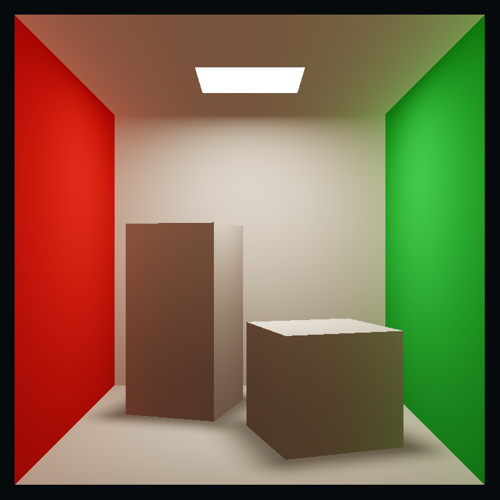
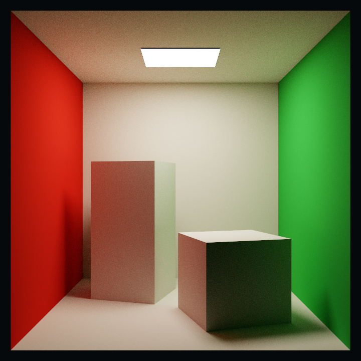
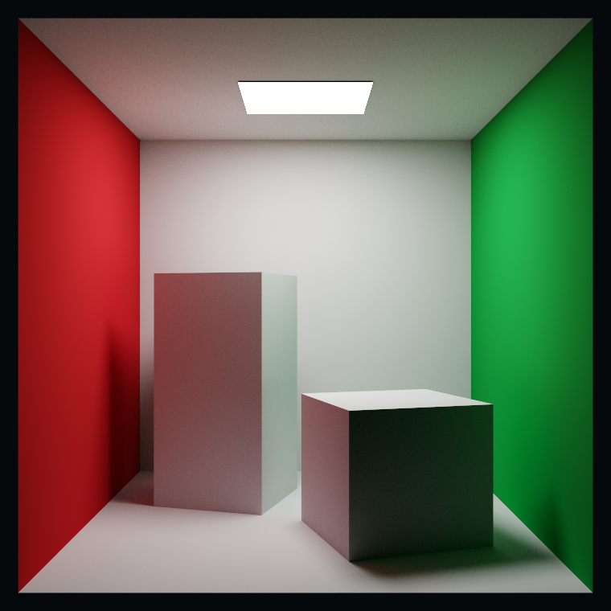
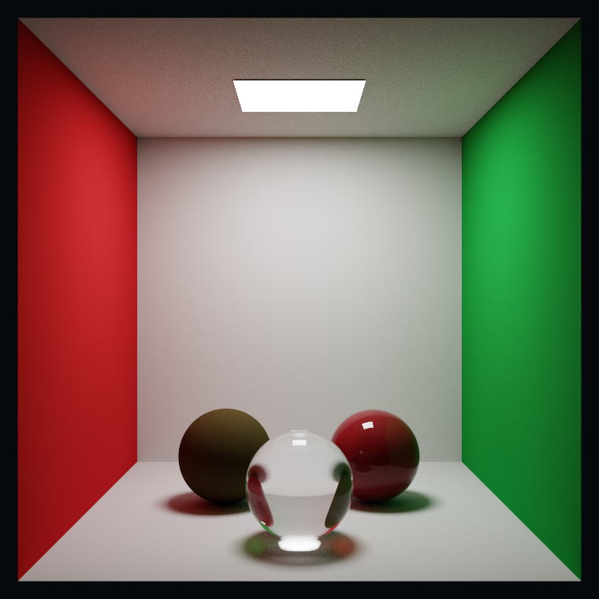

# Cornell box

The demo renders one Cornell box scene three ways. The vertex and mesh paths use the same geometry and lighting shader so their images should match. The ray query path uses the same triangles to build a Vulkan BLAS and TLAS, then traces visibility rays and up to five diffuse bounces per sample.

| Key | Mode | Vulkan path |
| --- | --- | --- |
| **1** | Vertex rasterization | Vertex buffer and `vkCmdDraw` |
| **2** | Mesh shader rasterization | `VK_EXT_mesh_shader` and `vkCmdDrawMeshTasksEXT` |
| **3** | Ray query path tracing | `VK_KHR_ray_query` and `VK_KHR_acceleration_structure` |

Press **S** to save a PNG of the current mode, or **Esc** to close the window. The title shows the active mode and reports when a requested mode is unavailable on the selected device.

## Build

Install a Vulkan loader and current Vulkan headers, SDL3, libpng, and glslang. For example, from the repository root:

```sh
cmake -S . -B build -DVENUS_BUILD_DEMO=ON -DVENUS_BUILD_HOST=OFF
cmake --build build --target venus-cornell
```

The demo requires Vulkan 1.2 at runtime. Mesh and ray query modes also require their corresponding Vulkan features. Use the Vulkan loader's `VK_DRIVER_FILES` environment variable to select the Venus ICD if your loader does not already discover it.

## Run

```sh
build/demo/venus-cornell --list-modes
build/demo/venus-cornell
build/demo/venus-cornell --headless --mode ray --width 720 --height 720 \
  --samples 384 --capture cornell-ray.png
```

Replace `--headless` with `--once` to present and capture one frame through the SDL window. The PNG is read back from the Vulkan color image used for presentation. Interactive ray query rendering defaults to 16 samples per pixel. Use `--samples` to change the quality.

For the throughput measurement, keep the window visible and run each mode
three times. The benchmark warms up for 30 frames and reports the pixel
extent, elapsed time, and application frame rate for the timed iterations.

```sh
build/demo/venus-cornell --mode raster --width 720 --height 720 --benchmark-frames 180
build/demo/venus-cornell --mode mesh --width 720 --height 720 --benchmark-frames 180
build/demo/venus-cornell --mode ray --width 720 --height 720 --samples 16 --benchmark-frames 180
```

## Captures

These 720×720 frames were rendered and presented with Venus on an NVIDIA RTX 4000 SFF Ada. The ray query capture used 384 samples per pixel.

| [Vertex rasterization](screenshots/cornell-raster.png) | [Mesh shader rasterization](screenshots/cornell-mesh.png) | [Ray query path tracing](screenshots/cornell-ray.png) |
| --- | --- | --- |
|  |  |  |

## Measured Cornell scenes

The optional ray query scenes use the demo's room and camera with Cornell's
measured white, red, and green paint reflectance and tungsten lamp spectrum.
The shader uses a lookup table that integrates the lamp spectrum multiplied
by each combination of paint reflections against the CIE 1931 2° observer.
The render white-balances the lamp to D65 and uses the classic demo's
exposure. The sphere scene adds analytic intersections for a matte sphere,
a glossy red sphere, and a refractive glass sphere with an index of 1.50.
The sphere materials are illustrative.

The measurement files are supplied locally. Save the following to one
directory outside the checkout or under an ignored build directory.

| File | Source |
| --- | --- |
| `cornell.html` | [Cornell Computer Graphics Data](https://bowers.cornell.edu/computer-graphics/data), including the surface reflectance table |
| `boxsource.mat` | [Cornell's measured tungsten lamp spectrum](https://web.archive.org/web/20230523123315id_/http://www.graphics.cornell.edu/online/measurements/source-spectra/boxsource.mat) |
| `cie.csv` | [CIE 1931 standard observer CSV](https://files.cie.co.at/Publications-datasets/CIE_xyz_1931_2deg.csv), checksum and citation at [CIE](https://doi.org/10.25039/CIE.DS.xvudnb9b) |

With Python 3 available, configure CMake with the directory and build:

```sh
cmake -S . -B build-measured -DVENUS_BUILD_DEMO=ON -DVENUS_BUILD_HOST=OFF \
  -DVENUS_CORNELL_DATA_DIR=/absolute/path/to/measurement-files
cmake --build build-measured --target venus-cornell
```

Run either measured scene through Venus. Both select the Vulkan ray query
mode. Use `--once` to present and save one frame:

```sh
build-measured/demo/venus-cornell --scene measured-boxes --samples 2048
build-measured/demo/venus-cornell --scene measured-spheres --samples 2048 \
  --width 760 --height 760 --once --capture cornell-spheres.png
```

These 760×760 captures used 2,048 samples per pixel on the RTX 4000 SFF Ada.

| Measured boxes | Measured spheres |
| --- | --- |
|  |  |
